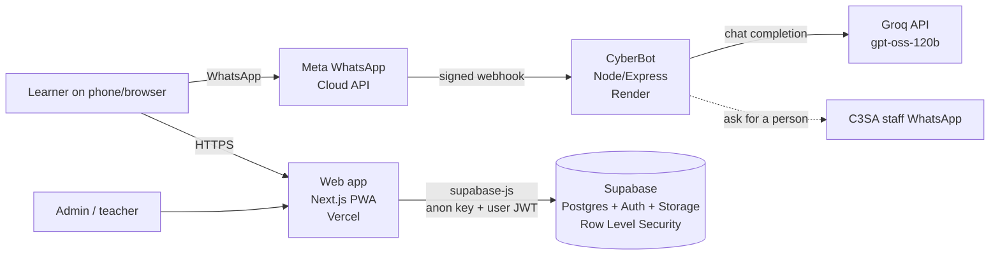

# CyberSafe

A cyber-safety platform for South African learners, built with **C3SA** (a non-profit).
Learners can take short modules and quizzes, read scam guides, share and read moderated
community reports, find emergency contacts, and chat with **CyberBot** on WhatsApp about
cyberbullying and online scams.

## Architecture



There is no separate application server. The web app talks to Supabase directly, and the
database enforces who may do what:

- **Row Level Security (RLS)** on every table: learners see only their own progress,
  community posts are visible only once approved, and only admins can write content.
- **Server-side functions** for anything that must not be trusted to the browser:
  - `submit_quiz()` grades a quiz and is the *only* way progress is saved.
  - `check_quiz_answer()` reveals the correct answer for one question after it is answered.
  - `admin_save_learning_content()` saves a module and its quiz in one transaction.
  - `validate_new_post()` rejects reports that are too short or too long, or carry oversized images.
  - `post_flags` records "Report post" flags (one per person per post). Admins see them under the "flagged" filter in `/admin/community`.
  - `set_post_display_name()` sets a post's public name from the author's username, so it cannot be faked.
  - `auto_hide_reported_post()` returns a post to review after 3 reports.
  - `post_like_counts` is a view that gives public "helpful" counts without revealing who liked what.
  - `is_admin()` is the shared role check used by policies.
- Roles (`learner`, `teacher`, `admin`) live in `profiles` and cannot be changed from the browser.
- Guests (anonymous sign-in) can learn and use the library/help pages but cannot post or report. Guest progress belongs to that browser and is not carried over if the person later creates an account.

### How the community feed is moderated

1. A signed-in learner (not a guest) writes a post in the feed or fills in the report form.
2. It is saved in `posts` with status `pending`. Only the author can see it, marked "Pending review".
3. A C3SA admin opens `/admin/community`, reads it, and approves or removes it.
4. Approved posts appear for everyone. Readers can mark a post helpful, share it, or report it.
5. When 3 different people have reported a post, the database sends it back to `pending` automatically. When an admin re-approves it, only *new* reports count.

The server enforces this, not just the screens: signed-out visitors cannot insert posts, nobody can approve their own post, and the public name is set from the author's username by the database (or "Anonymous" if they ticked that box). Admins can still see who wrote an anonymous post.

### How comments are moderated

Comments work differently from posts, on purpose. A review queue for every reply would make a conversation unusable, so comments appear straight away and safety comes from other controls:

1. Only signed-in members (not guests or signed-out visitors) can comment, on approved posts only. Comments are 1 to 500 characters, and a person can post at most 10 in 10 minutes.
2. The public name is set by the database from the member's username, so it cannot be faked.
3. Readers can report a comment. When 3 different people have reported it, it is hidden automatically until an admin looks at it. When an admin restores it, only *new* reports count.
4. Admins moderate comments on the same page as posts: `/admin/community`, **Comments** tab. The default view is "Reported". They can restore, hide or remove a comment. Removed comments stay in the database for records.

## Repository layout

| Path | What it is |
| --- | --- |
| `apps/web` | Next.js 15 / React 19 web app (installable PWA). Pages are in `src/app/*`. |
| `whatsapp-bot` | CyberBot: Express webhook + Groq. `index.js` (server), `bot-logic.js` (AI + safety), `commands.js` (typed commands), `security.js` (webhook signature check), `test/` (automated tests). |
| `supabase` | `schema.sql` (initial schema), `migrations/` (dated changes), `seed_*.sql` (starter content). |

## Running it locally

### 1. Web app
```bash
cd apps/web
npm install
cp .env.example .env.local   # then fill in the two values below
npm run dev                  # http://localhost:3000
```
| Variable | Where to find it |
| --- | --- |
| `NEXT_PUBLIC_SUPABASE_URL` | Supabase → Project Settings → API |
| `NEXT_PUBLIC_SUPABASE_ANON_KEY` | Supabase → Project Settings → API (the *anon/public* key only) |

Without these the app still starts in a demo mode so the UI can be worked on.

### 2. CyberBot
```bash
cd whatsapp-bot
npm install
npm test        # 27 automated tests, no API keys needed
npm start
```
| Variable | Purpose |
| --- | --- |
| `GROQ_API_KEY` | Groq API key for the AI replies |
| `WHATSAPP_TOKEN` | Meta permanent access token |
| `PHONE_NUMBER_ID` | WhatsApp phone number ID from Meta |
| `VERIFY_TOKEN` | Any secret string; must match what you enter in Meta's webhook setup |
| `APP_SECRET` | Meta app secret. **Required**: the bot refuses to start without it |
| `STAFF_WHATSAPP` | C3SA staff number (international format, no `+`) that receives "talk to a person" requests |
| `STAFF_TEMPLATE_NAME` | Recommended. Name of an approved WhatsApp message template with one body variable (the learner's number). WhatsApp only delivers plain text to a number that messaged the bot in the last 24 hours, so without a template the staff message can fail. If it fails, the learner is told honestly and given the helplines. |
| `STAFF_TEMPLATE_LANG` | Language code of that template (default `en`) |
| `PORT` | Optional, defaults to 3000 |
| `ALLOW_UNSIGNED_WEBHOOKS` | `true` skips the signature check. **Local testing only, never in production** |

Webhook URL for Meta: `https://<your-render-url>/webhook`.

### 3. Database (Supabase)
1. Create a Supabase project and enable the Google provider and anonymous sign-ins under Authentication if you want those login options.
2. Run `supabase/schema.sql` in the SQL Editor, then the files in `supabase/migrations/` **in filename order**, then the `seed_*.sql` files.
3. Make someone an admin (this cannot be done from the app, by design):
   ```sql
   update public.profiles set role = 'admin' where id = '<user uuid>';
   ```

> **Known gap in the SQL files.** The `"Quizz"` table, the `"Tier"` type, and a few columns on
> `modules` were created in the Supabase dashboard and are not in `schema.sql`, so the SQL files alone
> cannot rebuild a database from scratch. To fix this, export the real schema from the
> production project and commit it as the new baseline:
> `supabase db dump --schema public -f supabase/baseline.sql`.

## Safety design (CyberBot)

- **Crisis keywords** (English, Afrikaans, isiXhosa, isiZulu, Sepedi, Sesotho) force the emergency numbers (Childline 116, SADAG, SAPS) onto the reply even if the AI forgets them.
- The **"Get help now"** button never goes through the AI; it always returns the real numbers straight away.
- **"Talk to a person"** asks for consent before sending the learner's number to C3SA staff.
- Phone numbers and message text are **not logged**. Chat history is held in memory only. It is deleted after 30 minutes of silence or when the learner taps "End chat", and everything else about a learner (language choice, phone number) is forgotten after 24 hours of silence.
- Every webhook call is checked against Meta's HMAC signature, and duplicate message IDs are ignored.
- Each person is limited to 30 typed messages per 10 minutes, and messages are shortened to 1,500 characters before going to the AI. Buttons, commands and anything mentioning a crisis are never limited.

## Deployment

| Part | Host | Notes |
| --- | --- | --- |
| Web app | Vercel | Root directory `apps/web`; set the two `NEXT_PUBLIC_*` variables. |
| CyberBot | Render | Start command `npm start`; set all bot variables. A deploy without `APP_SECRET` fails on purpose and the previous version keeps running. |
| Database | Supabase | Apply new files from `supabase/migrations/` in order. |

## Known limitations and next steps

- **Bot memory is per-process.** A restart clears active chats, and the bot cannot run on more than one instance. Moving sessions into Supabase or Redis is the next step.
- **Crisis detection is keyword-based**, so it will miss misspellings and slang. It is a safety net behind the AI's own judgement, not a replacement for human follow-up.
- **The bot's languages** are English, Afrikaans, Sepedi and isiXhosa. Other languages get a best-effort AI reply.
- **Comments are not reviewed before they appear.** They are checked afterwards (reports, auto-hide at 3, admin removal). A post's comments disappear when the post is sent back to review.
- **The Notification Center shows sample alerts**, and the page says so. Live notifications are not built.
- **Several Settings options say "Coming soon"** (2FA, SMS/email/push alerts, language, text size, high contrast). Password reset by email works.
- **Guests cannot turn their progress into an account.** Linking a guest to an email or Google login needs Supabase's manual identity linking to be switched on and tested.
- **No offline mode.** The emergency numbers on the Help page need a data connection to load the first time. A service worker would fix this but needs real-browser testing.
- **"Save" and "Hide" on feed posts are kept on that device only.**
- **No automated tests for the web app yet**; the bot has 27 (including an end-to-end test of "Talk to a person" against a fake WhatsApp server), the database changes were checked against a real Postgres database, and the grading logic was checked against a real Postgres database.
- **Content moderation is manual**: admins approve every community report before it is shown.

## Handover checklist (for C3SA)

- [ ] Transfer ownership of the Supabase project, Vercel project, Render service and Meta/WhatsApp Business account.
- [ ] Rotate every key in this README's tables and store them in C3SA's own password manager.
- [ ] Create admin accounts for C3SA staff (see step 3 above) and train them to moderate reports and edit modules at `/admin`.
- [ ] Confirm `STAFF_WHATSAPP` points to a staffed number, set up a WhatsApp template and `STAFF_TEMPLATE_NAME`, test "Talk to a person" once, and agree response times.
- [ ] In Supabase, go to Authentication, then URL Configuration, and add `https://<your-domain>/reset-password` to the Redirect URLs. Password reset emails do not work without it.
- [ ] Decide who handles POPIA data requests (the Settings page tells learners to ask the C3SA team) and publish a contact for them.
- [ ] Agree who pays for Supabase, Render, Groq and WhatsApp conversation fees, and set usage alerts.
- [ ] Review the privacy notice against POPIA, especially for learners under 18 and anonymous reports.
