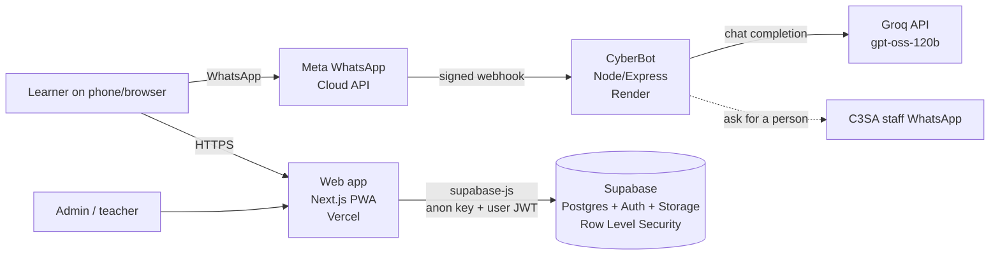

# CyberSafe

A cyber-safety platform for South African learners, built with **C3SA** (a non-profit).
Learners can take short modules and quizzes, read scam guides, share and read moderated
community reports, find emergency contacts, and chat with **CyberBot** on WhatsApp about
cyberbullying and online scams.

## Architecture



There is no separate application server. The web app talks to Supabase directly, and the
database enforces who may do what:

- **Row Level Security (RLS)** on every table: learners see only their own progress,
  community posts are visible only once approved, and only admins can write content.
- **Server-side functions** for anything that must not be trusted to the browser:
  - `submit_quiz()` grades a quiz and is the *only* way progress is saved.
  - `check_quiz_answer()` reveals the correct answer for one question after it is answered.
  - `admin_save_learning_content()` saves a module and its quiz in one transaction.
  - `is_admin()` is the shared role check used by policies.
- Roles (`learner`, `teacher`, `admin`) live in `profiles` and cannot be changed from the browser.
- Guests (anonymous sign-in) can learn and use the library/help pages but cannot post reports.

## Repository layout

| Path | What it is |
| --- | --- |
| `apps/web` | Next.js 15 / React 19 web app (installable PWA). Pages are in `src/app/*`. |
| `whatsapp-bot` | CyberBot: Express webhook + Groq. `index.js` (server), `bot-logic.js` (AI + safety), `commands.js` (typed commands), `security.js` (webhook signature check), `test/` (automated tests). |
| `supabase` | `schema.sql` (initial schema), `migrations/` (dated changes), `seed_*.sql` (starter content). |

## Running it locally

### 1. Web app
```bash
cd apps/web
npm install
cp .env.example .env.local   # then fill in the two values below
npm run dev                  # http://localhost:3000
```
| Variable | Where to find it |
| --- | --- |
| `NEXT_PUBLIC_SUPABASE_URL` | Supabase → Project Settings → API |
| `NEXT_PUBLIC_SUPABASE_ANON_KEY` | Supabase → Project Settings → API (the *anon/public* key only) |

Without these the app still starts in a demo mode so the UI can be worked on.

### 2. CyberBot
```bash
cd whatsapp-bot
npm install
npm test        # 13 automated tests, no API keys needed
npm start
```
| Variable | Purpose |
| --- | --- |
| `GROQ_API_KEY` | Groq API key for the AI replies |
| `WHATSAPP_TOKEN` | Meta permanent access token |
| `PHONE_NUMBER_ID` | WhatsApp phone number ID from Meta |
| `VERIFY_TOKEN` | Any secret string; must match what you enter in Meta's webhook setup |
| `APP_SECRET` | Meta app secret. **Required**: the bot refuses to start without it |
| `STAFF_WHATSAPP` | C3SA staff number (international format, no `+`) that receives "talk to a person" requests |
| `PORT` | Optional, defaults to 3000 |
| `ALLOW_UNSIGNED_WEBHOOKS` | `true` skips the signature check. **Local testing only, never in production** |

Webhook URL for Meta: `https://<your-render-url>/webhook`.

### 3. Database (Supabase)
1. Create a Supabase project and enable the Google provider and anonymous sign-ins under Authentication if you want those login options.
2. Run `supabase/schema.sql` in the SQL Editor, then the files in `supabase/migrations/` **in filename order**, then the `seed_*.sql` files.
3. Make someone an admin (this cannot be done from the app, by design):
   ```sql
   update public.profiles set role = 'admin' where id = '<user uuid>';
   ```

> **Known gap in the SQL files.** The `"Quizz"` table, the `"Tier"` type, and a few columns on
> `modules` were created in the Supabase dashboard and are not in `schema.sql`, so the SQL files alone
> cannot rebuild a database from scratch. To fix this, export the real schema from the
> production project and commit it as the new baseline:
> `supabase db dump --schema public -f supabase/baseline.sql`.

## Safety design (CyberBot)

- **Crisis keywords** (English, Afrikaans, isiXhosa, isiZulu, Sepedi, Sesotho) force the emergency numbers (Childline 116, SADAG, SAPS) onto the reply even if the AI forgets them.
- The **"Get help now"** button never goes through the AI; it always returns the real numbers straight away.
- **"Talk to a person"** asks for consent before sending the learner's number to C3SA staff.
- Phone numbers and message text are **not logged**. Chat history is held in memory only and expires after 30 minutes of silence or when the learner taps "End chat".
- Every webhook call is checked against Meta's HMAC signature, and duplicate message IDs are ignored.

## Deployment

| Part | Host | Notes |
| --- | --- | --- |
| Web app | Vercel | Root directory `apps/web`; set the two `NEXT_PUBLIC_*` variables. |
| CyberBot | Render | Start command `npm start`; set all bot variables. A deploy without `APP_SECRET` fails on purpose and the previous version keeps running. |
| Database | Supabase | Apply new files from `supabase/migrations/` in order. |

## Known limitations and next steps

- **Bot memory is per-process.** A restart clears active chats, and the bot cannot run on more than one instance. Moving sessions into Supabase or Redis is the next step.
- **Crisis detection is keyword-based**, so it will miss misspellings and slang. It is a safety net behind the AI's own judgement, not a replacement for human follow-up.
- **The bot's languages** are English, Afrikaans, Sepedi and isiXhosa. Other languages get a best-effort AI reply.
- **No automated tests for the web app yet**; the bot has 13, and the grading logic was checked against a real Postgres database.
- **Content moderation is manual**: admins approve every community report before it is shown.

## Handover checklist (for C3SA)

- [ ] Transfer ownership of the Supabase project, Vercel project, Render service and Meta/WhatsApp Business account.
- [ ] Rotate every key in this README's tables and store them in C3SA's own password manager.
- [ ] Create admin accounts for C3SA staff (see step 3 above) and train them to moderate reports and edit modules at `/admin`.
- [ ] Confirm `STAFF_WHATSAPP` points to a staffed number and agree response times.
- [ ] Agree who pays for Supabase, Render, Groq and WhatsApp conversation fees, and set usage alerts.
- [ ] Review the privacy notice against POPIA, especially for learners under 18 and anonymous reports.
